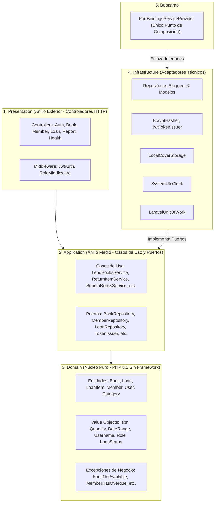

# Manager Library — Backend API (PHP / Laravel 10)

> **Evaluación Técnica · Ficha ADSO 3413974 · SENA**  
> Implementación del Backend de *Manager Library* bajo metodología **SDD** (*Spec-Driven Development*) y **Arquitectura Limpia / Cebolla (Onion)**.

---

## 🏛️ 1. Arquitectura Hexagonal / Cebolla (Onion)

El backend respeta estrictamente los artículos de la **Constitución** (`constitution.md`):



* **Artículo I (Dominio Puro):** `App\Domain` no depende de ninguna clase de Laravel, Symfony ni librerías externas. Solo PHP 8.2 estándar.
* **Artículo II (Inversión de Dependencias):** La capa de aplicación define interfaces (puertos) para todo lo que requiere del exterior.
* **Artículo III (Punto Único de Composición):** `PortBindingsServiceProvider` es el único lugar donde se asocian interfaces a implementaciones.
* **Artículo IV (SOLID):** Cada caso de uso tiene una responsabilidad única (SRP).
* **Artículo V (Propiedad del Esquema):** Todas las tablas, restricciones e índices viven en las migraciones de Laravel dentro del esquema `library`.
* **Artículo VII (Valores Derivados):** El estado del préstamo (`open`, `overdue`, `closed`) y los días de retraso se calculan en memoria y nunca se persisten en columnas redundantes.
* **Artículo VIII (Snapshot Congelado):** `loan_item` congela `book_title`, `isbn` y `category_name` en el instante del préstamo (ADR-004).

---

## 📋 2. Matriz de Cumplimiento de Reglas de Negocio

| Regla | Descripción | Dónde se cumple | Código HTTP |
|---|---|---|---|
| **RN-1** | Copias disponibles entre 0 y total | `Book::withdraw()`, `Book::restock()` + Check SQL | `409` si falta stock |
| **RN-2** | Plazo de 14 días; máx. 3 libros sin devolver por socio | `LendBooksService` | `422 MEMBER_LIMIT_EXCEEDED` |
| **RN-3** | Socio con libros vencidos no puede pedir más | `LendBooksService` | `409 MEMBER_HAS_OVERDUE` |
| **RN-4** | Valores congelados en la línea no siguen al catálogo | `LoanItem` + `EloquentReportReader` | Consistencia histórica |
| **RN-5** | Préstamos inmutables; libros con baja lógica | `Loan`, `Book::deactivate()` | `409` si hay préstamos abiertos |
| **RN-6** | Instantes UTC; cuerpo de error único `{code, message, details}` | `Handler.php` + Value Objects | Formato JSON universal |

---

## 🛠️ 3. Endpoints de la API (`/api/v1`)

### Autenticación y Salud
* `GET /health` — Salud del servicio (`{"status":"ok"}`).
* `POST /api/v1/auth/login` — Autenticación con JWT (8 horas de vigencia).

### Libros y Portadas
* `GET /api/v1/books` — Búsqueda paginada con filtro de texto (`q`) y categoría (`category_id`).
* `GET /api/v1/books/{id}` — Detalle del libro.
* `POST /api/v1/books` — Creación (Admin).
* `PUT /api/v1/books/{id}` — Actualización de catálogo y copias totales (Admin).
* `DELETE /api/v1/books/{id}` — Baja lógica protegida si hay préstamos activos (Admin).
* `PUT /api/v1/books/{id}/cover` — Subida de portada JPG/PNG (máx. 2 MB) (Admin).
* `DELETE /api/v1/books/{id}/cover` — Eliminación de portada (Admin).
* `GET /api/v1/books/{id}/cover` — Descarga del binario de portada.

### Socios
* `GET /api/v1/members` — Listado paginado de socios.
* `GET /api/v1/members/{id}` — Detalle con contador de préstamos activos (`active_loans`).
* `POST /api/v1/members` — Registro de socio con documento único.

### Préstamos y Devoluciones
* `POST /api/v1/loans` — Registro atómico de préstamo (1 a 3 libros).
* `GET /api/v1/loans` — Listado de préstamos filtrado por fechas, estado y socio.
* `GET /api/v1/loans/{id}` — Detalle con líneas y estado calculado (`open`, `overdue`, `closed`).
* `POST /api/v1/loans/{loanId}/items/{itemId}/return` — Devolución por línea con incremento de stock disponible.
* `GET /api/v1/loans/overdue` — Reporte operativo de líneas vencidas ordenadas por días de retraso.

### Reportes
* `GET /api/v1/reports/most-borrowed` — Libros más prestados por rango de fechas (Admin).

---

## 🧪 4. Pruebas Automatizadas

```bash
# Ejecución de pruebas unitarias y de arquitectura
./vendor/bin/phpunit --testdox
```
